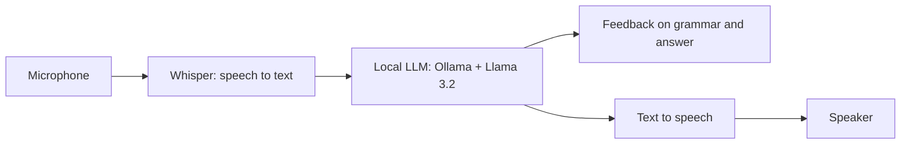

# Murugan S
### AI/ML Engineer in the Making

Building from fundamentals to production-ready AI systems: machine learning, LLM applications, RAG, agents, evaluation and deployment.

[LinkedIn](https://linkedin.com/in/murugan-s-f2004) · [GitHub](https://github.com/Murugan2004-ds) · [Email](mailto:muruganoff04@gmail.com)

---

## Contents

[About](#about) · [Career Goal](#career-goal) · [Skills](#skills) · [Roadmap Progress](#roadmap-progress) · [Projects](#projects) · [Interview Prep](#interview-prep) · [Progress Log](#progress-log) · [Contact](#contact)

---

## About

I hold a B.Tech in Artificial Intelligence and Data Science (2025) from Dhanalakshmi College of Engineering, Chennai. This repository is my public learning record and portfolio. It tracks a structured AI/ML Engineer roadmap, the projects I build along the way, and my progress, which I update regularly.

**How I learn**
- Structured course modules with lessons, examples and quizzes
- Hands-on practice with local open models through **Ollama**, so my learning does not depend on paid APIs
- Free resources first
- Every module is paired with notes or code, and projects are built alongside the theory

## Career Goal

An **AI/ML Engineer** role: someone who can build with LLMs (RAG and agents) and also train, evaluate, deploy and monitor models.

Open to: AI/ML Engineer, AI Engineer and Generative AI Developer roles, and internships. Based in Chennai, India.

---

## Skills

| Area | Tools | Status |
|------|-------|--------|
| Core | Python, SQL, Git and GitHub | Core |
| Data and statistics | NumPy, Pandas, Matplotlib, statistics | Learning |
| Machine learning | scikit-learn: regression, classification, ensembles, clustering | Learning |
| Deep learning | Keras, PyTorch | Planned |
| NLP and LLMs | Transformers, embeddings, prompting, Hugging Face, Ollama | Planned |
| RAG and agents | LangChain, LlamaIndex, LangGraph, MCP | Planned |
| Evaluation and safety | RAGAS, DeepEval, NeMo Guardrails | Planned |
| Observability and deployment | Langfuse, FastAPI, Docker, MLflow | Planned |
| Speech | Whisper, text-to-speech | Planned |

*Status key: Core = used regularly, Learning = in progress now, Planned = on the roadmap.*

---

## Roadmap Progress

| # | Module | What it covers | Status |
|---|--------|----------------|--------|
| 01 | Python for AI | Core Python, functions, files and JSON, OOP, async and retries, type validation, pytest, logging | In progress |
| 02 | Statistics | Descriptive and inferential statistics, probability, distributions, hypothesis testing | In progress |
| 03 | Machine Learning | Regression, regularization, classification metrics, trees, ensembles, SVM, unsupervised learning | Not started |
| 04 | Deep Learning | Perceptron, backpropagation, activations, loss functions, optimizers, CNNs | Not started |
| 05 | Natural Language Processing | Preprocessing, embeddings, RNN, LSTM, attention, transformers | Not started |
| 06 | LLM Fundamentals | How LLMs generate text, sampling controls, prompting, production concerns | Not started |
| 07 | Generative AI and Agentic AI | RAG, agents, quantization and fine-tuning, production | Not started |
| 08 | LangChain | Agents, tools, memory, middleware, safety | Not started |
| 09 | LlamaIndex | Retrieval, chunking, querying, shipping a RAG app | Not started |
| 10 | RAGAS | RAG metrics, LLM-as-a-judge, running evaluations | Not started |
| 11 | LangGraph | Graphs and state, memory and control, building and shipping an agent | Not started |
| 12 | Model Context Protocol | Tools, resources, prompts, building an agent over MCP | Not started |
| 13 | DeepEval | LLM, RAG and agent evaluation, datasets, test suites | Not started |
| 14 | NeMo Guardrails | Colang, input and output rails, a guarded assistant | Not started |
| 15 | Langfuse | Tracing, prompt management, scores and experiments | Not started |
| 16 | AI Security | LLM security, agent memory, AgentOps, deploying and scaling | Not started |

**Beyond the course** (skills AI/ML roles also expect)

- [ ] Math for ML: linear algebra, probability, basic calculus
- [ ] PyTorch
- [ ] Hugging Face Transformers and fine-tuning with LoRA and QLoRA
- [ ] Vector databases: Chroma, FAISS
- [ ] FastAPI and Docker
- [ ] MLOps: MLflow, DVC, CI/CD basics
- [ ] Cloud basics: AWS deployment
- [ ] ML system design

---

## Projects

### 1. Voice Interview Assistant
**Status:** Planned

A local, free voice assistant for practicing spoken English and technical interviews. It asks interview questions out loud, listens to my answers, and gives feedback on both grammar and answer quality.

- **Stack:** Python, Whisper, Ollama, a text-to-speech model
- **Planned features:** question bank by topic (LLMs, RAG, agents, SQL), per-answer feedback, session history
- **Skills shown:** LLM prompting, speech pipelines, local model deployment, API design

### 2. RAG App on My Own Documents
**Status:** Planned

A question-answering app over my own notes and documents with cited answers.

- **Stack:** Python, LlamaIndex, a vector store (Chroma or FAISS), Ollama
- **Planned features:** document loading and chunking, retrieval with reranking, cited answers, evaluation with RAGAS
- **Skills shown:** RAG design, retrieval quality, evaluation

### 3. Fine-tuned Small Model
**Status:** Planned

Fine-tune a small open model on a focused task and measure the improvement.

- **Stack:** Python, Hugging Face, PyTorch, LoRA
- **Planned features:** dataset preparation, training, before and after evaluation
- **Skills shown:** fine-tuning, evaluation, model comparison

---

## Interview Prep

- [ ] LLM Fundamentals, RAG, Agentic AI, Evals and Guardrails, LLMOps and AI System Design question sets (easy, intermediate and hard)
- [ ] DSA, SQL and aptitude practice
- [ ] ML and statistics fundamentals revision
- [ ] Explaining my own projects clearly, out loud

---

## Progress Log

| Date | Update |
|------|--------|
| Oct 2026 | Started the roadmap. Python for AI and Statistics in progress. Set up local models with Ollama. |

---

## Contact

- Email: [muruganoff04@gmail.com](mailto:muruganoff04@gmail.com)
- LinkedIn: [linkedin.com/in/murugan-s-f2004](https://linkedin.com/in/murugan-s-f2004)
- GitHub: [github.com/Murugan2004-ds](https://github.com/Murugan2004-ds)
